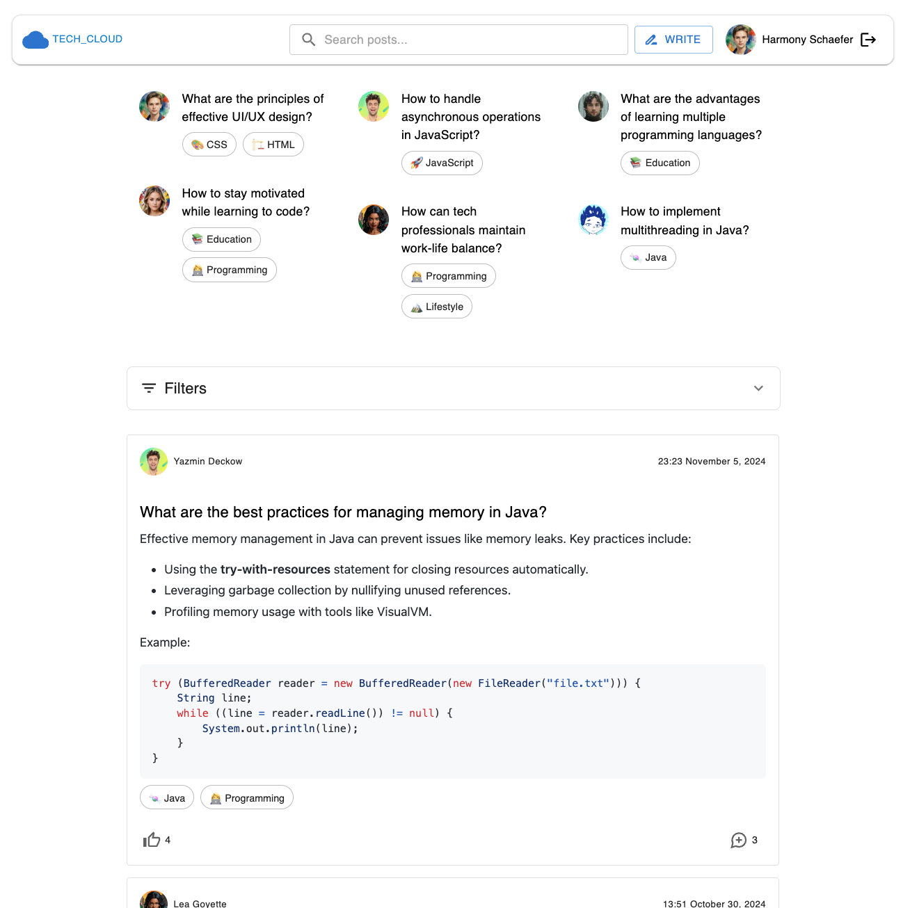
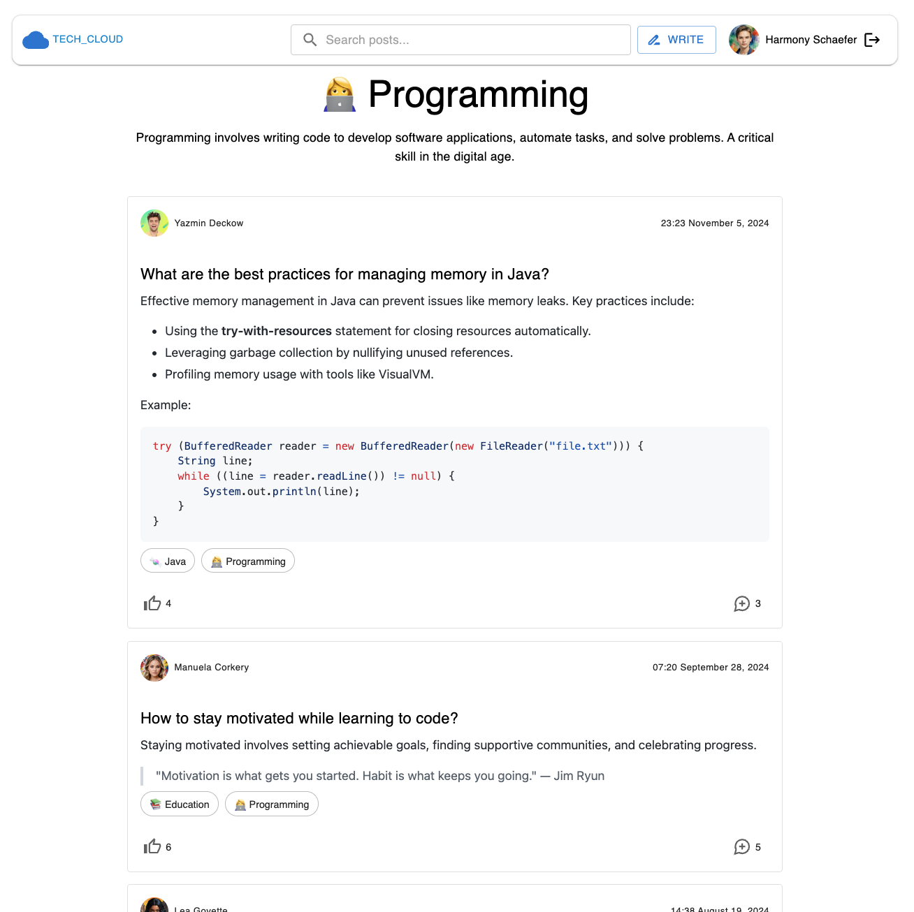
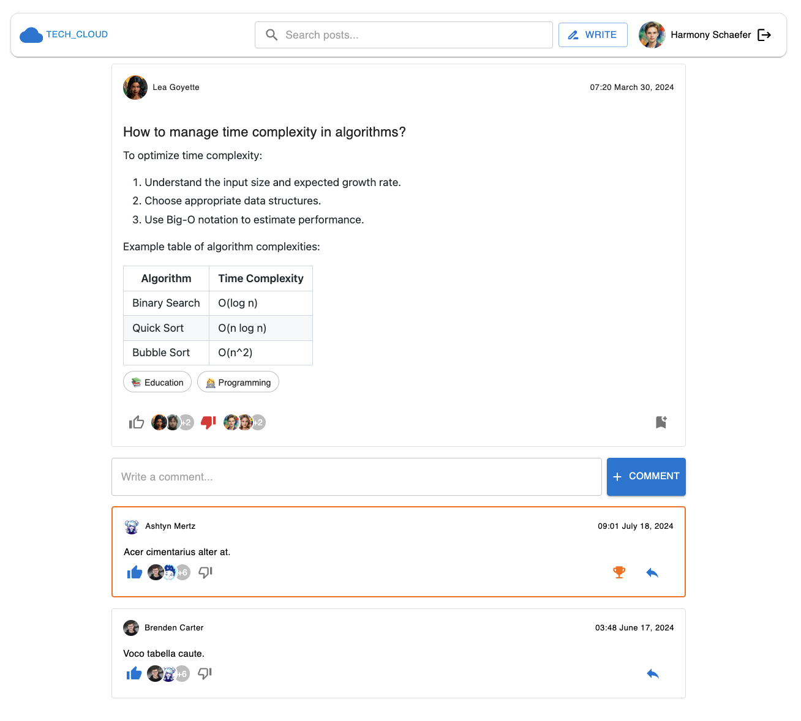

# Tech_Cloud

## Short Description
This project is a backend API built with Express.js for a platform similar to Stack Overflow, named **Tech_Cloud**. 
The API allows users to register, log in, post questions, add comments, like/dislike posts, and manage other interactions.

## Requirements and Dependencies
- **Node.JS** >= v22
- **NPM** >= v10
- **MySQL** >= 8.0

Before starting, ensure the required technologies are installed.

## How to Run the Solution
1. First you need to install back-end part. Clone this repository to your local machine and navigate to the project directory.
   ```bash
   git clone https://github.com/InessaRepeshko/tech-cloud-backend
   ```
2. You need to go to the folder with the back-end part and follow all the steps from [README.md](https://github.com/InessaRepeshko/tech-cloud-backend) there. After that, you should continue to follow the steps in this guide.
3. Install React, Redux and other front-end parts.
   ```bash
   npm install
   ```
4. Run the server to start the application.
   ```bash
   npm run start
   ```

## Fake Data
All users with role `user` has password: `$User2024`. It's fake data for presentations.
### User logins for presentations
* ashtyn72
* manuela.corkery
* yazmin.deckow17
* griffin_murazik4
* brenden41
* lyda.gerhold
* harmony15
* lea.goyette

### Admin for presentations
   ```text
      login: admin
      email: admin@techcloud.com
      password: $Admin2024
   ```

## Ethereal for emails
[Ethereal](https://ethereal.email/) is a fake SMTP service, mostly aimed at Nodemailer and EmailEngine users (but not limited to). It's a completely free anti-transactional email service where messages never get delivered.
To view the letter that the user will receive, you need to log in to this service using a test login and password.
```text
login: ricky43@ethereal.email
password: 4e1zbM2nxsMu2d823E
```

## Additional Features
- Favorite posts - users can add posts to favorites and see this list.
- Most useful comment - the author of the post can set the most useful comments that solved their problem described in the post. Only post authors can set this value.
- Most interesting posts - administrators can select the posts that will be displayed on the main page of the site. Usually these are the most interesting posts.

## Presentation
### Main Page

### User Page

### Category Page

### Post Page
